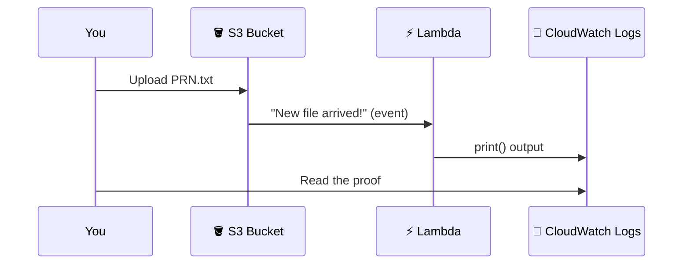

# ⚡ Lab 1: Your First Lambda, From "Hello" to S3-Triggered

> **Think of Lambda as a chef who only shows up when an order arrives.**
> No order, no chef, no cost. An order arrives (a file upload), the chef cooks (your code runs), then leaves.

By the end of this lab you will have built this:



> [!NOTE]
> Everywhere you see `<PRN>`, type your own PRN (example: `123456`).

## 🎯 Your mission

| Level | Goal | Proof to show |
|:---:|---|---|
| 🟢 1 | Create `Lambda_<PRN>` that returns `Hello from <PRN>` | Test output |
| 🟡 2 | Make the message appear in CloudWatch | Log screenshot |
| 🔴 3 | Make an S3 upload trigger Lambda automatically | Log with the uploaded file name |

📚 Want the theory first? [Handler, event, context](../concepts/02-handler-event-context.md) · [S3 trigger](../concepts/03-s3-trigger-and-event.md)

---

# 🟢 Level 1: Say Hello

## Step 1: Create the function

**Lambda → Create function → Author from scratch**

| Setting | Value |
|---|---|
| Function name | `Lambda_<PRN>` |
| Runtime | Python 3.12 (or another available Python runtime) |
| Architecture | x86_64 |
| Execution role | Create a new role with basic Lambda permissions |

Click **Create function**.

> [!TIP]
> The "basic Lambda permissions" role lets your function write logs. That is why `print()` will work later without any extra setup.

## Step 2: Write the code

**Code tab → open `lambda_function.py` → replace everything with:**

```python
def lambda_handler(event, context):
    return {
        'statusCode': 200,
        'body': 'Hello from <PRN>'
    }
```

Now click **Deploy**.

> [!WARNING]
> **Deploy saves your code. Test runs it.** Forget Deploy and Lambda keeps running your old code. This is the most common beginner mistake.

## Step 3: Test it

**Test tab → Create new event**

| Setting | Value |
|---|---|
| Event name | `MyTestEvent` |
| Event JSON | `{}` |

Click **Save**, then **Test**.

✅ **You should see:**

```json
{
  "statusCode": 200,
  "body": "Hello from <PRN>"
}
```

📸 **Take a screenshot of this result.**

---

# 🟡 Level 2: Find Your Message in the Logs

## Step 4: Look at CloudWatch

**Monitor tab → View CloudWatch logs → open the latest log stream**

You will see only three lines:

```
START RequestId: ...
END RequestId: ...
REPORT RequestId: ...
```

🤔 **Where is "Hello"?** Lambda does not log your `return` value. It only logs what you `print()`.

| | Goes to |
|---|---|
| `return` | The Test result screen |
| `print()` | CloudWatch Logs |

## Step 5: Add a print

Replace the code, then **Deploy** and **Test** again:

```python
def lambda_handler(event, context):
    message = 'Hello from <PRN>'
    print(message)

    return {
        'statusCode': 200,
        'body': message
    }
```

Open the **newest** log stream. 🎉

✅ **You should see:**

```
START RequestId: ...
Hello from <PRN>
END RequestId: ...
REPORT RequestId: ...
```

📸 **Take a screenshot of this log.**

> [!TIP]
> No new log yet? Wait a few seconds and refresh. Logs can arrive a little late.

---

# 🔴 Level 3: Let S3 Wake Up Your Lambda

Now the real magic: you upload a file, and Lambda runs **by itself**.

## Step 6: Create the bucket

**S3 → Create bucket**

| Setting | Value |
|---|---|
| Bucket name | `lambda-prn-<PRN>` (must be globally unique) |
| Region | **Same as your Lambda** |
| Other settings | Default |

> [!IMPORTANT]
> Different region for bucket and Lambda is the #1 reason the trigger cannot be added.

## Step 7: Connect S3 to Lambda

**Lambda → your function → Function overview → Add trigger**

| Setting | Value |
|---|---|
| Source | S3 |
| Bucket | your new bucket |
| Event types | All object create events |
| Prefix | leave blank |
| Suffix | leave blank |

Tick the acknowledge warning, then click **Add**.

> [!NOTE]
> What just happened? You told S3: "when a new file lands here, ring Lambda's doorbell."

## Step 8: Teach Lambda to read the doorbell message

When S3 rings, it sends an **event** (a dictionary) with the bucket name and file name. Replace the code and **Deploy**:

```python
def lambda_handler(event, context):

    print("Lambda function invoked!")

    for record in event.get('Records', []):
        bucket = record['s3']['bucket']['name']
        filename = record['s3']['object']['key']

        print("Bucket:", bucket)
        print("Uploaded file:", filename)

    return {
        'statusCode': 200,
        'body': 'Hello from <PRN>'
    }
```

**How the code finds the file name:**

```
event
 └── Records            (a list)
      └── [each record]
           └── s3
                ├── bucket → name   →  "lambda-prn-<PRN>"
                └── object → key    →  "<PRN>.txt"
```

> [!TIP]
> `event.get('Records', [])` means "use Records if it exists, otherwise an empty list". It stops your old `{}` test event from crashing the function.

## Step 9: Pull the trigger 🚀

1. On your computer, create a text file named `<PRN>.txt` (any content).
2. **S3 → open your bucket → Upload → Add files → Upload**.
3. **Lambda → Monitor → View CloudWatch logs → newest log stream**.

✅ **You should see:**

```
Lambda function invoked!
Bucket: lambda-prn-<PRN>
Uploaded file: <PRN>.txt
```

📸 **Take a screenshot of this log.** You never clicked Test, and Lambda ran anyway. That is an event-driven system.

---

## 🧠 What you learned

- [x] A Lambda function is just `lambda_handler(event, context)`
- [x] **Deploy** saves code, **Test** runs it
- [x] `print()` goes to CloudWatch, `return` goes to the Test screen
- [x] S3 can trigger Lambda and passes the bucket and file name in `event`

## 🛠️ Stuck?

| Symptom | Fix |
|---|---|
| Old output after editing code | You forgot **Deploy** |
| Cannot add the S3 trigger | Bucket and Lambda are in different regions |
| Upload done but no new log | Check **Configuration → Triggers**, then refresh the log streams |
| `KeyError: 'Records'` | Use the `event.get('Records', [])` version of the code |

## 🧹 Clean up

Delete the Lambda function, then **empty** and **delete** the bucket.

---

➡️ **Next:** [Lab 2: Sales Total](02-sales-total.md)
