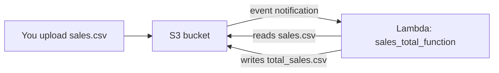

# Lab 2: Calculate Sales Total Automatically with Lambda

> **Idea:** You drop a messy sales file into a bucket. Without you clicking anything, Lambda opens it, adds up the money, and drops a clean result file right next to it.



> [!NOTE]
> Theory behind this lab: [S3 trigger and the infinite loop](../concepts/03-s3-trigger-and-event.md), [IAM role](../concepts/04-iam-and-cloudwatch.md), [code explained](../concepts/05-code-explained.md).

## What happens

1. User uploads raw sales data (`sales.csv`) to S3.
2. Lambda detects the new file.
3. Lambda calculates total sales and writes `total_sales.csv` to the same bucket.

## The data

**Input: `sales.csv`**

```csv
product,quantity,price
Laptop,2,60000
Mouse,5,500
Keyboard,3,1500
```

**Output: `total_sales.csv`**

```csv
Total_Sales
127000
```

**Where 127000 comes from:**

| Product | Quantity | Price | Quantity x Price |
|---|---:|---:|---:|
| Laptop | 2 | 60000 | 120000 |
| Mouse | 5 | 500 | 2500 |
| Keyboard | 3 | 1500 | 4500 |
| **Total** | | | **127000** |

## Mission checklist

- [ ] Step 1: Create the S3 bucket
- [ ] Step 2: Create the Lambda function and add the code
- [ ] Step 3: Give Lambda permission to use S3
- [ ] Step 4: Make S3 trigger Lambda
- [ ] Step 5: Upload `sales.csv` and check the output

---

## Step 1: Create the S3 bucket

**S3 > Create bucket**

| Setting | Value |
|---|---|
| Bucket name | `yourname-sales-lambda-demo-2026` (must be globally unique, lowercase) |
| Region | The region you will use for Lambda (keep both the same) |
| Other settings | Default |

## Step 2: Create the Lambda function

**Lambda > Create function > Author from scratch**

| Setting | Value |
|---|---|
| Function name | `sales_total_function` |
| Runtime | Python 3.x |

Click **Create function**. Then open the **Code** tab, replace the code in `lambda_function.py` with the code below, and click **Deploy**.

(Same code is available at `https://github.com/newdelthis/demo/blob/main/sales_total_function_lambda.py`.)

```python
import json
import boto3
import csv
import io

s3 = boto3.client('s3')


def lambda_handler(event, context):

    # Get bucket and file name from event
    bucket = event['Records'][0]['s3']['bucket']['name']
    key = event['Records'][0]['s3']['object']['key']

    # Avoid infinite loop if Lambda reads its own output file
    if key == "total_sales.csv":
        return

    # Read uploaded CSV file
    response = s3.get_object(Bucket=bucket, Key=key)
    lines = response['Body'].read().decode('utf-8').splitlines()

    reader = csv.DictReader(lines)

    total_sales = 0

    for row in reader:
        total_sales += int(row['quantity']) * int(row['price'])

    print("Total Sales:", total_sales)

    # Create output CSV in memory
    output = io.StringIO()
    writer = csv.writer(output)

    writer.writerow(["Total_Sales"])
    writer.writerow([total_sales])

    # Upload result file to same bucket
    s3.put_object(
        Bucket=bucket,
        Key="total_sales.csv",
        Body=output.getvalue()
    )

    return {
        "statusCode": 200,
        "total_sales": total_sales
    }
```

> [!WARNING]
> Click **Deploy** after pasting. Without it, Lambda still runs the old default code.

### Understand the code in 60 seconds

| Part of the code | What it does |
|---|---|
| `s3 = boto3.client('s3')` | Gives Python a connection to S3 |
| `event['Records'][0]...` | Reads the bucket name and file name out of the event S3 sent |
| `if key == "total_sales.csv": return` | Ignores our own output file (explained below) |
| `s3.get_object(...)` | Downloads the uploaded file |
| `.read().decode('utf-8').splitlines()` | Turns the file into a list of text lines |
| `csv.DictReader(lines)` | Uses the first line as column names, so each row is `{'product': 'Laptop', 'quantity': '2', 'price': '60000'}` |
| `int(row['quantity']) * int(row['price'])` | CSV values are text, so convert to numbers, then multiply |
| `print("Total Sales:", ...)` | Writes to CloudWatch Logs |
| `io.StringIO()` + `csv.writer` | Builds the output CSV in memory, no local file needed |
| `s3.put_object(...)` | Saves `total_sales.csv` into the same bucket |

### Why the "avoid infinite loop" line exists

Lambda writes `total_sales.csv` into the bucket that triggers it. Without the check:

```
Upload sales.csv -> Lambda writes total_sales.csv -> S3 sees a new file -> Lambda runs again -> writes again -> ...
```

It would repeat forever and cost money. The `if key == "total_sales.csv": return` line stops the loop at the first repeat.

## Step 3: Give Lambda permission to use S3

A new function can only write logs. It is not allowed to touch S3 until you say so.

1. On the Lambda function page, open the **Configuration** tab.
2. Open **Permissions**.
3. Click the **execution role name** shown there. This opens IAM.
4. In IAM, click **Add permissions > Attach policies**.
5. Search for and select **AmazonS3FullAccess**.
6. Click **Add permissions**.

> [!NOTE]
> `AmazonS3FullAccess` is fine for learning. In real projects you would allow only `s3:GetObject` and `s3:PutObject` on one bucket.

## Step 4: Configure S3 to trigger Lambda

1. Go back to **S3** and open your bucket.
2. Open the **Properties** tab.
3. Scroll to **Event notifications** and click **Create event notification**.

| Setting | Value |
|---|---|
| Event notification name | `sales-upload-trigger` |
| Event types | All object create events |
| Destination | Lambda function |
| Lambda function | `sales_total_function` |

4. Click **Save**.

> [!IMPORTANT]
> `sales-upload-trigger` is only the **name of the notification**. The function you select as the destination is `sales_total_function`.

## Step 5: Upload and check the output

1. Save the sample data above as `sales.csv` on your computer (or download it from `https://github.com/newdelthis/demo/blob/main/sales.csv`).
2. Open your bucket and **Upload** `sales.csv`.
3. Refresh the bucket object list.

**You should see two files:**

```
sales.csv
total_sales.csv
```

4. Open or download `total_sales.csv`. It should contain:

```csv
Total_Sales
127000
```

**Screenshot:** the bucket showing both files, and the contents of `total_sales.csv`.

Also check the log: **Lambda > Monitor > View CloudWatch logs > latest log stream** should show:

```
Total Sales: 127000
```

## If the output file is not created

Go to **Lambda > Monitor > CloudWatch Logs**, open the latest log, and read the error.

| Error in the log | Cause and fix |
|---|---|
| `AccessDenied` | Step 3 is missing. Attach `AmazonS3FullAccess` to the execution role |
| `KeyError: 'quantity'` | The CSV header is wrong. It must be `product,quantity,price` |
| `ValueError: invalid literal for int()` | A quantity or price is not a whole number |
| No new log at all | The trigger was not saved (Step 4), or the bucket and Lambda are in different regions |
| Old behaviour after editing code | You forgot **Deploy** |

## Clean up

1. Delete the Lambda function.
2. **Empty** the S3 bucket, then **delete** it.

---

