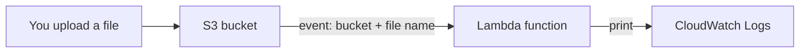

# Lab 4: Trigger Lambda from S3 and Read the Event Details

> **Idea:** S3 is a doorbell. When a file lands in the bucket, S3 rings Lambda and hands it a note saying which bucket and which file. Your code reads that note and prints it.



> [!NOTE]
> This lab starts from an existing Lambda function (for example `Lambda_<PRN>` from [Lab 1](01-hello-and-s3-trigger.md)). Replace `<PRN>` with your own PRN everywhere (example: `123456`).

## Mission

| Part | Goal |
|:---:|---|
| 1 | Create an S3 bucket |
| 2 | Add the bucket as a trigger on your Lambda |
| 3 | Change the code to print the bucket name and uploaded file name |
| 4 | Upload a file and find the output in CloudWatch |

Theory: [How S3 triggers Lambda](../concepts/03-s3-trigger-and-event.md)

---

## Part 1: Create the S3 bucket

**S3 > Create bucket**

| Setting | Value |
|---|---|
| Bucket name | `lambda-prn-<PRN>` (must be globally unique, lowercase) |
| Region | **Same region as your Lambda function** |
| Other settings | Default |

Click **Create bucket**.

> [!IMPORTANT]
> If the bucket and the Lambda are in different regions, the trigger cannot be added. Check the region at the top right of the console before you create the bucket.

## Part 2: Add the bucket as a Lambda trigger

**Lambda > open your function > Function overview > Add trigger**

| Setting | Value |
|---|---|
| Source | S3 |
| Bucket | Select your newly created bucket |
| Event types | All object create events |
| Prefix | Leave blank |
| Suffix | Leave blank |

Tick the **acknowledge** warning, then click **Add**.

**You should see:** the S3 box appear on the left side of the Function overview, connected to your function.

> [!NOTE]
> The warning is about recursive invocation: if your function writes into the same bucket that triggers it, it can loop forever. This lab only prints, so it is safe.

## Part 3: Modify the code

**Code tab > open `lambda_function.py` > replace the code:**

```python
def lambda_handler(event, context):

    print("Lambda function invoked!")

    for record in event['Records']:
        bucket = record['s3']['bucket']['name']
        filename = record['s3']['object']['key']

        print("Bucket:", bucket)
        print("Uploaded file:", filename)

    return {
        'statusCode': 200,
        'body': 'Hello from <PRN>'
    }
```

Click **Deploy**.

### How the code reads the event

S3 sends this (shortened) when you upload `<PRN>.txt`:

```json
{
  "Records": [
    {
      "s3": {
        "bucket": { "name": "lambda-prn-<PRN>" },
        "object": { "key": "<PRN>.txt" }
      }
    }
  ]
}
```

| Code | Gives you |
|---|---|
| `event['Records']` | A list with one record per uploaded file |
| `for record in ...` | Visits each record |
| `record['s3']['bucket']['name']` | `lambda-prn-<PRN>` |
| `record['s3']['object']['key']` | `<PRN>.txt` (the file name) |

> [!WARNING]
> This code needs a real S3 event. If you press **Test** with the empty event `{}`, it fails with `KeyError: 'Records'`. That is expected. Test by uploading a file instead.

## Part 4: Upload a file and check the logs

1. Create any small text file on your computer, for example `<PRN>.txt`.
2. **S3 > open your bucket > Upload > Add files > Upload**.
3. **Lambda > your function > Monitor > View CloudWatch logs > open the latest log stream**.

**You should see:**

```
START RequestId: ...
Lambda function invoked!
Bucket: lambda-prn-<PRN>
Uploaded file: <PRN>.txt
END RequestId: ...
REPORT RequestId: ...
```

**Screenshot:** take a screenshot of this log.

Upload a second file with a different name and open the newest log stream again. The `Uploaded file:` line changes. Every upload is one separate Lambda run.

## Stuck?

| Symptom | Fix |
|---|---|
| Cannot add the trigger | Bucket and Lambda are in different regions |
| Uploaded but no new log | Check **Configuration > Triggers** shows S3, then refresh the log streams after a few seconds |
| Log shows old output | Code was not **Deployed** |
| `KeyError: 'Records'` | You used the Test button with `{}`. Upload a file instead |

## Clean up

Delete the Lambda function, then empty and delete the bucket.
